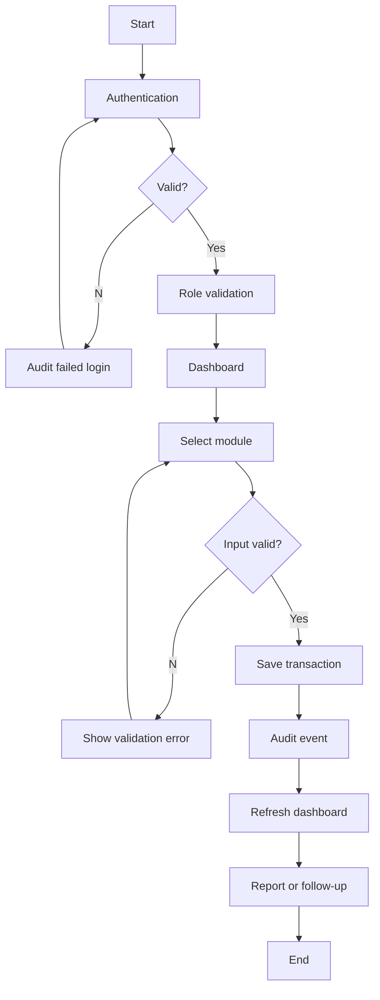
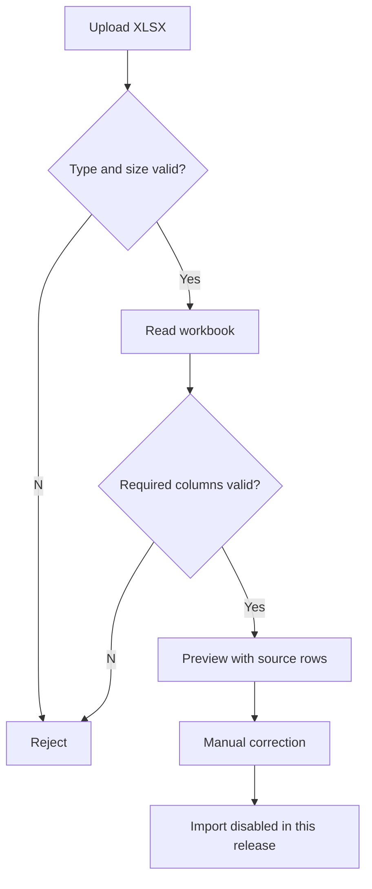
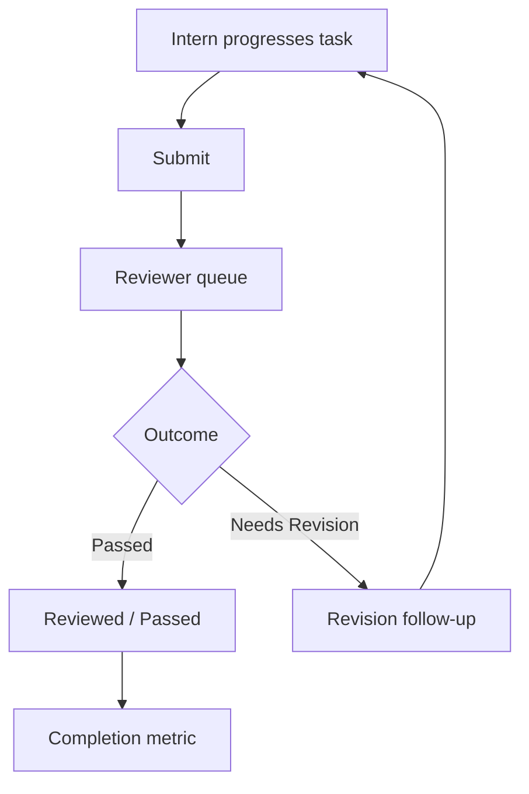
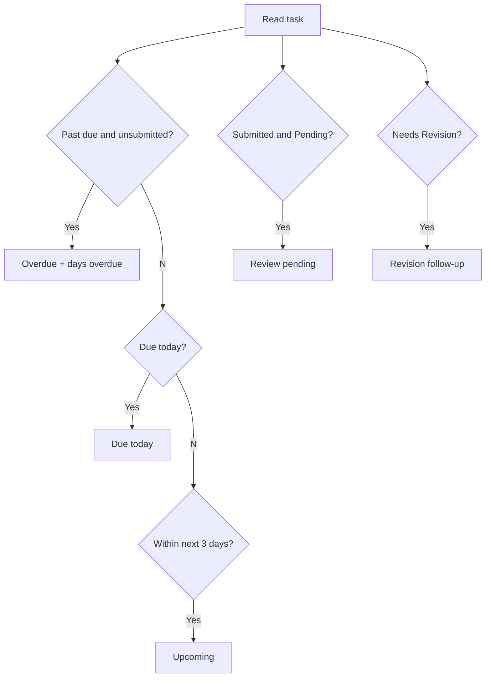
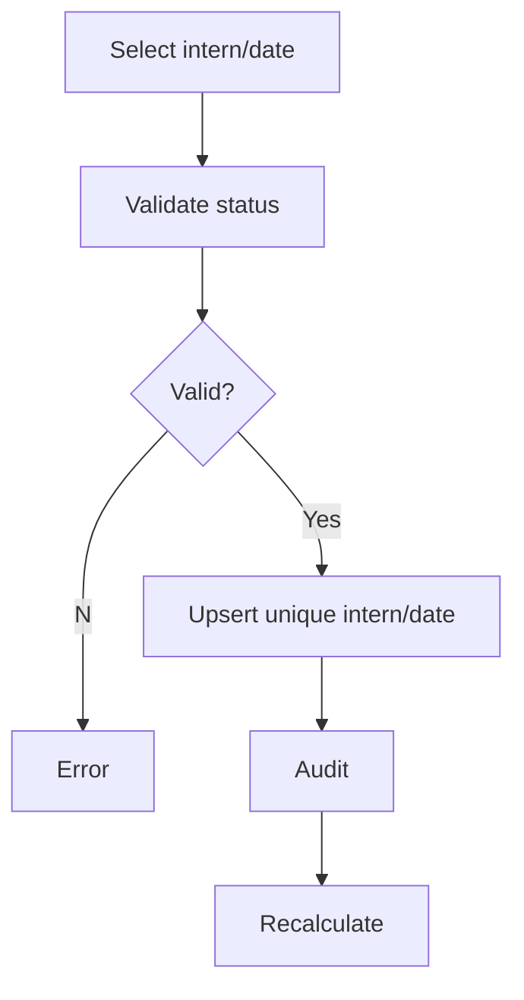
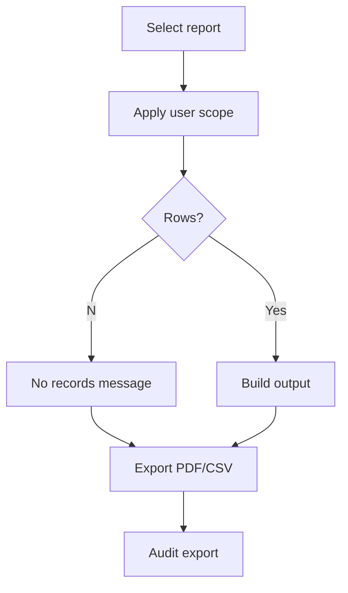

# Project Report — 
## Abstract
A Streamlit and SQLite system to centralize internship records, teams, task lifecycle, attendance, assessments, deadline follow-up and reporting.
## Business problem
Spreadsheet-based tracking can create duplicate IDs, missed deadlines and inconsistent reporting. The system applies validation, scope restrictions and database constraints.
## Architecture
Streamlit UI → service functions → SQLite schema; Pandas/OpenPyXL handle workbook templates and exports; Plotly charts dashboard data; ReportLab creates PDF output.
## Workflow

## Excel import

## Submission and assessment

## Deadline monitoring

## Attendance

## Reports

## Limitations
Excel imports are preview-only; SMTP email scheduling is not active; restoration is an offline documented operation; the exact DIT logo was not present in the uploaded ZIP. SQLite is for demos/small teams.
